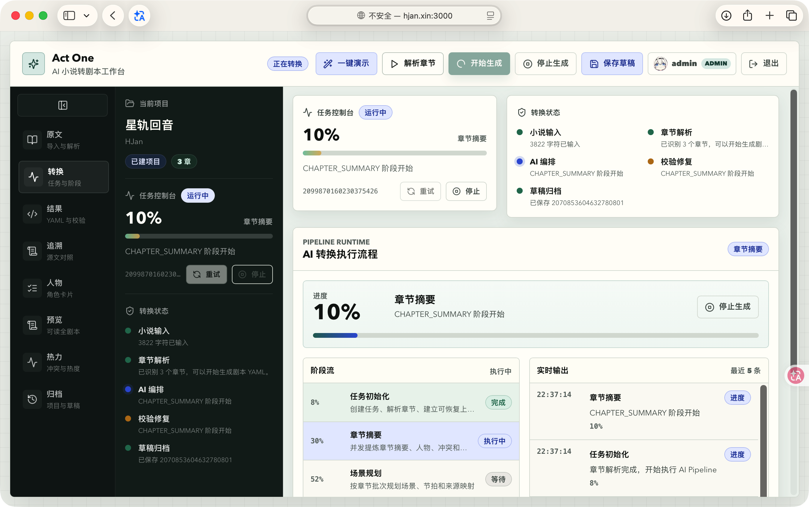
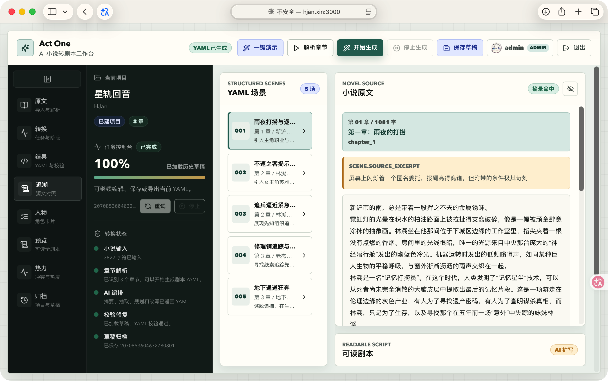
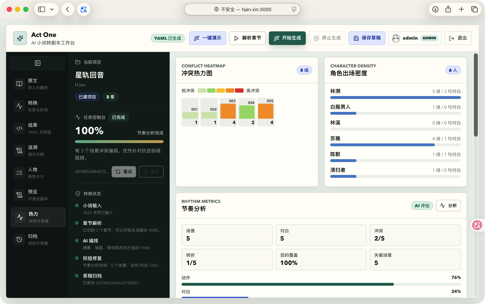

# Act One

**AI 小说转剧本工作台**

将小说转换为可编辑的结构化剧本初稿，支持来源追溯、场景精修和节奏分析，帮助小说作者与编剧从原文走向场景、动作和对白。

**导入小说 → 生成剧本 → 核对原文 → 精修与导出**

[演示视频](https://www.bilibili.com/video/BV1CVEh6zEnt/) · [在线演示](http://hjan.xin:3000) · [快速开始](#快速开始) · [剧本格式](docs/script-yaml-schema.md) · [开发文档](docs/development.md)

> 在线演示服务器资源有限，并行 AI 调用可能导致服务不可用，完整体验建议本地部署。视频另有 [备用地址](http://hjan.xin:9001/helloqiniu/act-one.mp4)。

## 产品展示

### 从小说到剧本

导入小说、解析章节，查看生成进度，并在工作台编辑剧本 YAML。



<details>
<summary>查看来源追溯与节奏分析</summary>

### 来源追溯

按场景核对来源章节与原文摘录，审查改编依据。



### 节奏分析

查看节奏、冲突指标与角色出场密度，辅助调整叙事安排。



</details>

## 核心功能

| 创作环节 | 可以做什么 |
| --- | --- |
| 导入小说 | 输入正文、预览章节；支持中文章节识别和长章节分块，要求至少 3 章 |
| 生成剧本 | 分阶段生成摘要、场景规划和剧本 YAML；支持流式进度、任务取消与失败任务安全阶段恢复 |
| 核对来源 | 查看场景对应的来源章节、原文摘录和阶段结果 |
| 精修内容 | 指定场景局部精修、对白口吻重写、生成分镜建议 |
| 分析节奏 | 查看节奏分析、冲突指标和角色出场密度 |
| 管理与导出 | 管理项目、保存与编辑草稿、导出 YAML 文件 |

内置演示小说《星轨回音》，可用于首次体验。项目也提供登录、用户管理和修改密码功能。

## 快速开始

本地运行结构：

```text
浏览器 → React / Vite（5173）→ Spring Boot（10001）→ PostgreSQL（5432）
                                                → 百炼模型 API
```

需要 Java 17+、Maven 3.9+、Node.js 18+（建议使用仍受维护的 LTS 版本），以及已启动的 PostgreSQL。以下命令适用于 macOS / Linux，数据库示例使用本地 `postgres` 账号。

### 1. 获取代码并初始化数据库

```bash
# 克隆项目；私有仓库需要先配置 GitHub 访问权限
git clone https://github.com/HJan0113/act-one.git
cd act-one
```

[数据库脚本](sql/act-one.sql) 只创建表结构，包含删除同名表的语句。请在新建的本地数据库中执行：

```bash
# 创建本地开发数据库，并导入表结构；按提示输入数据库密码
createdb -h localhost -p 5432 -U postgres act_one
psql -h localhost -p 5432 -U postgres -d act_one -v ON_ERROR_STOP=1 -f sql/act-one.sql

# 检查表结构，预期能看到 t_user、t_script_project 等 7 张业务表
psql -h localhost -p 5432 -U postgres -d act_one -c '\dt'
```

脚本不包含初始用户。为本地演示创建管理员：

```bash
# 仅在新建的本地数据库执行，创建 admin / admin 演示账号
psql -h localhost -p 5432 -U postgres -d act_one -v ON_ERROR_STOP=1 <<'SQL'
INSERT INTO public.t_user (id, username, password, role)
VALUES ('local-demo-admin', 'admin', 'admin', 'admin');
SQL
```

预期输出 `INSERT 0 1`。该账号仅用于本地演示，部署到共享环境前请更换密码。

### 2. 配置环境变量

```bash
# 在仓库根目录执行，复制后端配置模板
cp backend/.env.example backend/.env
```

编辑 `backend/.env`，填写数据库密码和模型 Key：

```dotenv
ACT_ONE_DB_URL='jdbc:postgresql://localhost:5432/act_one?client_encoding=UTF8'
ACT_ONE_DB_USERNAME=postgres
ACT_ONE_DB_PASSWORD='your_local_postgres_password'
BAILIAN_API_KEY='your_bailian_api_key'
SILICONFLOW_API_KEY=''
```

配置值建议保留单引号，避免密码或 URL 中的特殊字符被 Shell 解释。

当前启用的模型候选均使用百炼，需配置 `BAILIAN_API_KEY`，并确认账号可访问配置中的模型。提供方、模型名称和优先级见 [application.yml](backend/src/main/resources/application.yml) 的 `ai` 配置；仅填写 `SILICONFLOW_API_KEY` 不会切换模型提供方。

没有可用模型 Key 时，应用仍可启动；AI 调用失败后会生成规则版脚手架，主要用于验证操作流程。

### 3. 启动后端

```bash
# 在仓库根目录执行，加载环境变量并启动后端
cd backend
set -a
source .env
set +a
mvn spring-boot:run
```

另开一个终端检查服务：

```bash
# 预期响应包含 code 为 "0"、data.status 为 "ok"
curl http://localhost:10001/api/health
```

健康接口用于确认 HTTP 服务可用；数据库连接和模型调用需在登录、生成流程中继续验证。

### 4. 启动前端并体验

在另一个终端进入仓库根目录：

```bash
# 安装前端依赖并启动开发服务
cd frontend
npm install
npm run dev
```

打开 [本地工作台](http://localhost:5173)，使用刚创建的 `admin / admin` 登录：

1. 点击「一键演示」加载《星轨回音》，或输入至少 3 章小说。
2. 点击「解析章节」，确认章节识别结果后生成剧本。
3. 查看生成结果与来源摘录，尝试场景精修和节奏分析。
4. 保存草稿并导出 YAML；草稿格式见 [剧本 YAML Schema](docs/script-yaml-schema.md)。

前端开发服务会将 `/api` 请求代理到 `http://localhost:10001`。

## 技术亮点

```text
小说文本 → 章节解析与分块 → 章节摘要 → 场景规划 → 剧本 YAML → Schema 校验
```

- **分阶段生成**：保存结构化中间结果，便于观察进度、排查失败和从安全阶段恢复任务。
- **来源追溯**：场景保留来源章节与原文摘录，让作者能够核对改编依据。
- **结构校验与降级**：校验生成的 YAML；模型调用或校验失败时返回规则版脚手架，并明确标记生成模式和失败原因。
- **模型路由**：跟踪候选模型健康状态，调用失败后尝试其他候选。

这些业务能力基于 Spring AI、Spring Boot 等框架实现。具体调用链、生成模式和包依赖方向见 [开发参考](docs/development.md)。

## 技术栈

| 层级 | 主要技术 |
| --- | --- |
| 前端 | React 18、TypeScript、Vite、lucide-react |
| 后端 | Java 17、Spring Boot 3.5、MyBatis-Plus、Sa-Token |
| AI 集成 | Spring AI 1.1、OpenAI 兼容接口、自定义 Pipeline 与模型路由 |
| 数据与格式 | PostgreSQL、SnakeYAML、剧本 YAML Schema |

依赖版本以 [backend/pom.xml](backend/pom.xml) 和 [frontend/package.json](frontend/package.json) 为准。

## 文档与开发

- [剧本 YAML Schema](docs/script-yaml-schema.md)：剧本结构、人物、场景与对白字段。
- [开发参考](docs/development.md)：生成链路、系统目录、API 概览、测试与构建命令。
- [数据库结构](sql/act-one.sql)：项目、章节、转换任务、阶段结果、草稿、草稿版本和用户表。
- [后端配置](backend/src/main/resources/application.yml)：数据库、模型提供方、路由与 Pipeline 参数。

代码仓库：[GitHub](https://github.com/HJan0113/act-one) · [Gitee](https://gitee.com/HJan0113/act-one)
